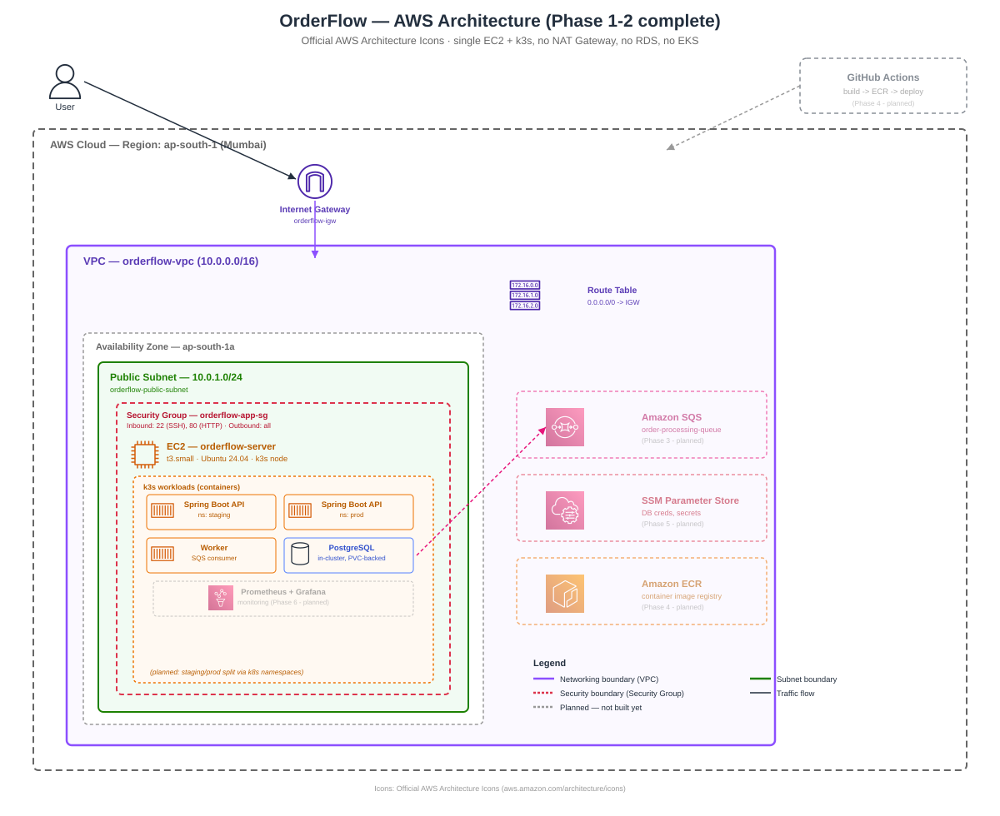
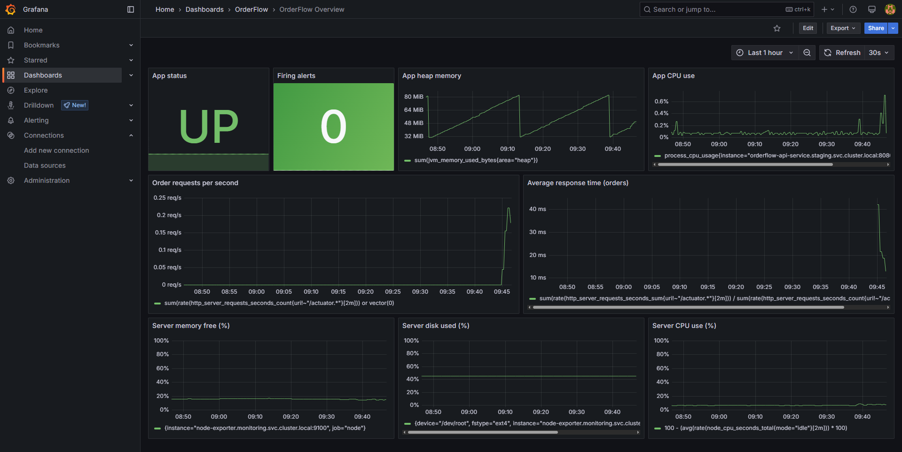

# OrderFlow — Production-Style Order Processing Platform on AWS

> Status: In progress. This README is updated at each phase as the project is built.

## What this project is

A small order-processing service (Spring Boot + Postgres + SQS worker) deployed
to a real AWS environment, built to demonstrate production-grade DevOps
practices within a strict $10-15/month budget.

This is a deliberately advanced follow-up to an earlier intern-level project
(CloudPath), built to go beyond tutorial-level Docker/Kubernetes into real
cloud infrastructure, CI/CD, secrets management, and observability.

## Architecture (high level)

Built so far:

- Single EC2 instance running k3s, with a staging namespace
- Postgres self-hosted in-cluster (not RDS, see Cost decisions below)
- AWS SQS for async order processing, with a background worker
- Custom VPC, public subnet only, no NAT Gateway (see Cost decisions below)
- Terraform with a reusable network module
- GitHub Actions builds the Docker image and pushes it to ECR using OIDC (no stored AWS keys)
- Secrets in AWS SSM Parameter Store, loaded into Kubernetes Secrets/ConfigMaps
- Prometheus + Grafana, with the dashboard stored as a file in this repo

Planned:

- Terraform remote state (S3 + DynamoDB locking)
- Automatic deploys, an approval gate, and a production namespace
- Server-level metrics and alerting
- Budget alert and auto-shutdown

## Cost decisions (and why)

| Decision | Alternative considered | Why this choice |
|---|---|---|
| EC2 + k3s | EKS | EKS control plane alone is ~$73/month, incompatible with a $10-15/month budget |
| Postgres in-cluster | RDS | RDS after free tier is ~$12-13/month, would consume the entire budget |
| No NAT Gateway | NAT Gateway | ~$32/month for a portfolio project with no real traffic isn't justified |
| SQS | Self-hosted Redis | SQS has a permanent (not just 12-month) free tier at this scale |

## Progress log

- [x] Phase 0 - Repo structure and planning
- [x] Phase 1 - Terraform networking (VPC, subnet, security group)
- [x] Phase 2 - EC2 + k3s cluster (resized t3.micro to t3.small due to memory constraints)
- [x] Phase 3 - Application (Spring Boot + Postgres + SQS worker)
- [x] Phase 4 - CI/CD: GitHub Actions builds and pushes the image to ECR (deploy is still manual; approval gate and prod promotion are planned)
- [x] Phase 5 - Secrets management (SSM Parameter Store + Kubernetes Secrets)
- [ ] Phase 6 - Observability (app dashboard done; server metrics and alerting in progress)
- [ ] Phase 7 - Cost controls (budget alert, auto-shutdown)
- [ ] Phase 8 - Final polish (diagram, evidence, LinkedIn post)

## Monitoring

Prometheus scrapes the app's metrics and Grafana shows them on an OrderFlow dashboard that is loaded from a file in this repo, so it comes back after every restart.

## Tech stack

Spring Boot, PostgreSQL, AWS (EC2, VPC, SQS, SSM Parameter Store, ECR, IAM),
Terraform, Kubernetes (k3s), GitHub Actions (OIDC), Docker, Prometheus, Grafana
